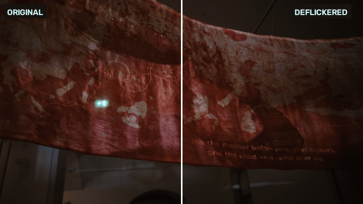
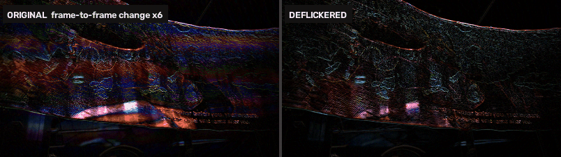
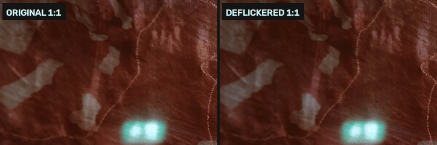
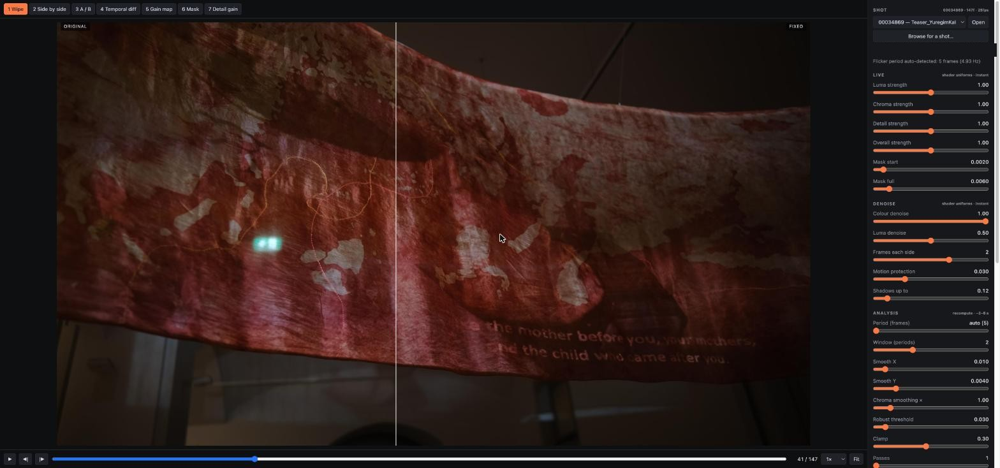
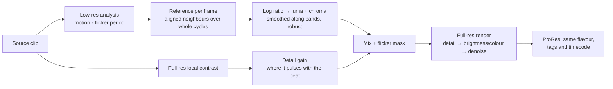

# Image-Based Deflicker

**Removes projector flicker from footage of projection-mapped and video installations** — the rolling bands, colour shifts and sharp/soft pulsing you get when a camera films a projector — where generic deflicker plugins (Resolve, After Effects) don't help.



<sub>Example footage: a projection-mapped museum installation, ProRes 4444 XQ, 25 fps. GIFs play at the real frame rate, so the flicker you see is the flicker in the file.</sub>

---

## Why generic deflicker fails here

When a camera films a projector, the projector's refresh (and its DLP colour wheel) beats against the camera's rolling shutter. The result is **not** a whole-frame brightness pumping, which is what deflicker plugins correct. It is:

| Artefact | What you see | Why |
|---|---|---|
| **Rolling bands** | horizontal light/dark stripes moving through the projected area | rows of the sensor are exposed at different moments of the projector cycle |
| **Colour flicker** | the bands also shift hue (blue most) | the DLP colour wheel shows R, G, B one after another |
| **Sharp/soft pulse** | every few frames the projected video looks soft or ghosted | the projector switches to its next video frame while the camera is still reading out |
| **Only on the projection** | walls, floor and visitors are stable | only projector light flickers |

The whole frame barely changes (0.1–0.5 %), while the projected areas change locally by 5–8 % — so global deflicker has nothing to grab.



<sub>Frame-to-frame change ×6. Left: the coloured rolling bands. Right: after deflicker, only real motion and grain remain.</sub>

## What it does

It treats the flicker as what it is: a **local, periodic** signal (here exactly one cycle every 5 frames, ≈5 Hz at 25 fps).

1. **Brightness** — per pixel, a reference is built from motion-aligned neighbouring frames averaged over *whole* flicker cycles, which cancels the beat exactly while keeping the (much slower) projected content. The correction is smoothed along the band direction and ignores people and parallax.
2. **Colour** — the same, separately for the colour components, so the colour-wheel hue shifts go too.
3. **Detail (sharp/soft pulse)** — local contrast is evened out over the same cycles, only where it really pulses with the beat, so grain in the blacks is left alone.
4. **Temporal denoise (optional)** — motion-protected averaging of aligned neighbours, luma and colour separately, shadows only by default. Calms the camera's blue-channel grain once the flicker no longer hides it.

Everything is masked to where flicker actually is, so the rest of the frame is untouched.



### Measured on the example shot

| | removed |
|---|---|
| Brightness flicker | **99.1 %** |
| Colour flicker red/green | **99.4 %** |
| Colour flicker blue/green | **99.2 %** |
| Overall brightness change | < 0.3 % |

<sub>Beat-frequency energy on local 8×8 tiles of the bright half of the frame, before vs after.</sub>

---

## Install

macOS (Apple Silicon or Intel) with Python 3.9+:

```bash
brew install ffmpeg
pip3 install -r requirements.txt
```

On macOS the export uses Apple's own ProRes encoder (VideoToolbox), which keeps fine grain far better than ffmpeg's `prores_ks`. Elsewhere it falls back to `prores_ks` automatically.

## Quick start

**Batch, from the command line:**

```bash
python3 deflicker.py "shots/"*.mov -o exports --preview
```

For every shot you get `<shot>_DF.mov` (same ProRes flavour, Rec.709 tags and timecode as the source), `<shot>_compare.mp4` (original | fixed side by side), `<shot>_mask.png` and `<shot>_settings.json`.

**With settings tuned in the app:**

```bash
python3 deflicker.py "shots/"*.mov -o exports --preset presets/mylook.json
```

Any single setting can also be overridden, e.g. `--smooth-x 0.005 --dn-luma 0`.

## Deflicker Lab — the tuning app

```bash
python3 ui/server.py "shots/shot01.mov"
# open http://localhost:8765
```



A local web app (WebGL2) to tune one shot and then batch the rest with the same preset.

- **Live sliders** are GPU shader uniforms — instant. They use exactly the same maths as the export.
- **Analysis sliders** recompute on the Python side in a few seconds.
- **Frames are shown at full resolution, uncompressed**, so what you judge is what you export.
- **Shots and output folder** can be switched from the app (native Finder dialogs on macOS).

**Compare views** `1`–`7`: Wipe · Side by side · A/B (with auto-flip) · Temporal diff · Gain map · Mask · Detail gain
**Inspect**: `C` cycles RGB / R / G / B / Luma · `H` high-pass filter (adjustable radius and gain) · hold `O` for the original · wheel to zoom, drag to pan
**Playback**: `Space` play, `←` `→` step, slow-motion speeds

**Measure** reports how much brightness, colour and sharp/soft flicker was removed. **Save** a preset, **Render shot** exports it at full quality.

<details>
<summary><b>All settings</b></summary>

| Setting | Default | What it does |
|---|---|---|
| **Live** | | |
| `luma` | 1.0 | strength of the brightness correction |
| `chroma` | 1.0 | strength of the colour correction |
| `detail` | 1.0 | strength of the sharp/soft correction |
| `strength` | 1.0 | multiplies everything |
| `mask_lo` / `mask_hi` | 0.002 / 0.006 | flicker energy where correction starts / is full; raise to protect non-projected areas |
| **Denoise** | | |
| `dn_chroma` | 1.0 | temporal colour-grain reduction (no softening) |
| `dn_luma` | 0.5 | temporal brightness-grain reduction (stronger = softer) |
| `dn_radius` | 2 | neighbouring frames on each side (0 = off) |
| `dn_threshold` | 0.03 | motion protection: neighbours differing more than this are ignored |
| `dn_shadows` | 0.12 | denoise only below this brightness, fading out by 2× (1 = everywhere) |
| **Analysis** | | |
| `period` | 0 (auto) | frames per flicker cycle |
| `periods` | 2 | cycles averaged for the reference |
| `smooth_x` / `smooth_y` | 0.01 / 0.004 | smoothing of the correction (fraction of width / height); lower follows projected detail more closely |
| `chroma_smooth` | 1.0 | extra smoothing for colour |
| `robust` | 0.03 | how strongly pixels that don't fit (people, parallax) are ignored |
| `clamp` | 0.3 | maximum correction (log units) |
| `passes` | 1 | run again on the corrected result |
| `detail_size` | 4 | size in px (full res) of the detail that pulses |
| `detail_coherence` | 0.25 | how clearly detail must follow the flicker rhythm to be corrected |
| `detail_smooth` | 0.0025 | smoothing of the detail correction |

</details>

## How it works



- The temporal window is a box of one flicker period convolved with itself, which has zeros at the beat frequency and all its harmonics — so the beat cancels exactly, not approximately.
- Motion is estimated by phase correlation and compensated as a translation, which handles tripod drift and pans.
- The correction is a gain map, smooth across the frame, so detail and grain pass through unchanged.

## Limitations

- What a band clipped or crushed can't be brought back — only brightness is evened out.
- A soft frame (two projected frames mixed) is evened out in contrast, not made truly sharp.
- Camera motion is modelled as translation; strong rotation or zoom will reduce the result.
- Long clips are previewed in the app at reduced resolution to fit GPU memory; the export is always full resolution.

## Project layout

```
deflicker.py      core + command line (analysis, correction, render)
ui/server.py      local server for the tuning app
ui/index.html     the app (WebGL2 shader mirrors deflicker.finalize / render / denoise)
presets/          saved looks (JSON), usable with --preset
docs/             README media
```
